# BandhSetu — Database Schema & Data Dictionary

This document specifies the complete relational schema, data dictionary, indexing strategy, foreign key cascades, and integrity constraints for the **BandhSetu** system.

---

## 1. Entity-Relationship Overview

```mermaid
erDiagram
    users {
        int id PK
        string email UK
        string phone UK
        string full_name
        string hashed_password
        string role
        boolean is_active
        boolean is_locked
        string lock_reason
        datetime locked_at
        string access_start_time
        string access_end_time
        datetime temporary_extension_until
        int token_version
        datetime last_login_at
        datetime created_at
    }

    workers {
        int id PK
        string serial_number UK
        string full_name
        string phone
        string town
        string city
        string village
        date joining_date
        string status
        text remarks
        int pending_pieces
        numeric payable_balance
        numeric total_earned
        datetime created_at
    }

    items {
        int id PK
        string item_name
        string item_code UK
        numeric price_per_piece
        text description
        boolean is_active
        datetime created_at
    }

    work_distributions {
        int id PK
        string batch_code
        int worker_id FK
        int item_id FK
        string item_name_snapshot
        string item_code_snapshot
        numeric rate_per_piece
        string knot_style
        int quantity_issued
        int quantity_returned
        int quantity_rejected
        int quantity_pending
        numeric total_gross_wage
        numeric deductions
        numeric bonus
        numeric net_payable
        date issue_date
        date due_date
        date return_date
        string status
        text qc_remarks
        text remarks
        datetime created_at
    }

    work_returns {
        int id PK
        string return_code UK
        int distribution_id FK
        int worker_id FK
        int item_id FK
        string item_name_snapshot
        numeric rate_per_piece_snapshot
        int quantity_returned
        int quantity_rejected
        string rejection_reason
        text rejection_remarks
        numeric completed_work_value
        date return_date
        int recorded_by_id FK
        string recorded_by_name
        text remarks
        datetime created_at
    }

    material_transactions {
        int id PK
        string transaction_code UK
        int worker_id FK
        int distribution_id FK
        int return_id FK
        int item_id FK
        string item_name
        string item_code
        date transaction_date
        string transaction_type
        int debit_qty
        int credit_qty
        int rejected_qty
        numeric rate_per_piece
        numeric total_value
        int running_balance
        int recorded_by_id FK
        string recorded_by_name
        boolean is_reversed
        datetime created_at
    }

    money_transactions {
        int id PK
        string transaction_code UK
        int worker_id FK
        int distribution_id FK
        int return_id FK
        int payment_record_id FK
        date transaction_date
        string transaction_type
        string description
        numeric credit_amount
        numeric debit_amount
        numeric running_balance
        string payment_mode
        string reference_no
        int recorded_by_id FK
        string recorded_by_name
        boolean is_reversed
        datetime created_at
    }

    payment_records {
        int id PK
        int worker_id FK
        int distribution_id FK
        string payment_type
        numeric amount
        string payment_mode
        string reference_no
        string disbursed_by_name
        date payment_date
        text notes
        datetime created_at
    }

    audit_logs {
        int id PK
        int user_id
        string user_email
        string user_role
        string action
        string ip_address
        string user_agent
        string details
        string timestamp_ist
        datetime created_at
    }

    workers ||--o{ work_distributions : "receives"
    workers ||--o{ work_returns : "submits"
    workers ||--o{ material_transactions : "ledger_entries"
    workers ||--o{ money_transactions : "ledger_entries"
    workers ||--o{ payment_records : "receives_disbursement"

    work_distributions ||--o{ work_returns : "partial_returns"
    work_distributions ||--o{ material_transactions : "distribution_txn"
    work_returns ||--o{ material_transactions : "return_txn"
    work_returns ||--o{ money_transactions : "earned_wage_credit"
    payment_records ||--o{ money_transactions : "payout_advance_debit"
```



---

## 2. Table Specifications

### 2.1 `users` (Admin & Manager Accounts)
Stores login profiles for the business owner and operational managers.
- `id`: Integer, Primary Key, Auto-increment.
- `email`: Varchar(255), Unique, Not Null, Indexed.
- `phone`: Varchar(30), Unique, Nullable, Indexed.
- `role`: Varchar(20), Not Null (`admin` or `manager`).
- `is_locked`: Boolean, Default `false`. If `true`, overrides working hours and blocks all access immediately.
- `access_start_time`: Varchar(10), Default `'09:00'` (IST).
- `access_end_time`: Varchar(10), Default `'20:00'` (IST).
- `token_version`: Integer, Default `1`. Incremented on manual lock or password change to revoke all active JWT sessions.

### 2.2 `workers` (Artisan Women)
Stores master profiles of 200–500 women artisans doing Bandhej knotting work.
- `serial_number`: Varchar(50), Unique, Not Null (`WRK-0001` through `WRK-9999`). Non-reusable sequential identifier.
- `full_name`, `phone`, `village`, `town`, `city`: Indexed for dynamic partial search.
- `pending_pieces`: Integer, Default `0`. Cached count of fabric pieces in artisan custody.
- `payable_balance`: Numeric(12, 2), Default `0.00`. Net outstanding wages owed to artisan: `Credits (Wages) - Debits (Advances + Payouts)`.
- `total_earned`: Numeric(12, 2), Default `0.00`. Cumulative lifetime wages earned from inspected accepted returns.

### 2.3 `items` (Item Catalogue)
Master list of fabric designs and unit piece rates.
- `item_name`: Varchar(255), Not Null.
- `item_code`: Varchar(100), Unique, Nullable (e.g., `GAJ-BHR-01`).
- `price_per_piece`: Numeric(10, 2), Not Null. Active tying rate per unit.
- `is_active`: Boolean, Default `true`.

### 2.4 `work_distributions` (Material Issuance)
Records consignment dispatches with historical price snapshot protection.
- `batch_code`: Varchar(50), Not Null (`DIST-YYYYMMDD-XXXX`).
- `rate_per_piece`: Numeric(10, 2), Not Null. **Permanent Snapshot Rate**. Locked at creation time; subsequent catalogue price adjustments never modify past batches.
- `quantity_issued`: Integer, Must be $> 0$.
- `quantity_returned`: Integer, Accepted finished pieces returned so far.
- `quantity_rejected`: Integer, Defective pieces rejected so far.
- `quantity_pending`: Integer, Calculated as `quantity_issued - quantity_returned - quantity_rejected`.
- `status`: Varchar(50) (`Issued`, `In Progress`, `Partially Returned`, `Completed`).

### 2.5 `work_returns` (QC Inspections & Wage Accruals)
Records partial or full returns of finished tying work.
- `return_code`: Varchar(50), Unique (`RET-YYYYMMDD-XXXX`).
- `quantity_returned`: Integer, Number of accepted pieces meeting quality standards.
- `quantity_rejected`: Integer, Defective pieces with flaws (broken knots, tears, dye bleed).
- `rejection_reason`: Varchar(100), Nullable.
- `completed_work_value`: Numeric(12, 2). Calculated as `quantity_returned * rate_per_piece_snapshot`. Only accepted pieces create wages.

### 2.6 `material_transactions` (Material Debit-Credit Ledger)
Maintains double-entry material tracking from the worker-account perspective:
- **DEBIT**: Fabric issued to artisan (`debit_qty`).
- **CREDIT**: Finished fabric returned by artisan (`credit_qty`).
- `running_balance`: Net pieces remaining in worker custody.
- `is_reversed`: Boolean. Supports auditable reversals without hard deletes.

### 2.7 `money_transactions` (Money Debit-Credit Ledger)
Maintains double-entry financial tracking from the worker-account perspective:
- **CREDIT**: Wages earned from accepted returns (`WORK_EARNING`) and bonuses (`BONUS_CREDIT`).
- **DEBIT**: Cash/UPI advances taken (`ADVANCE_GIVEN`) and wage payouts made (`WAGE_PAYOUT`).
- `running_balance`: Net rupees currently owed to the artisan.
- `is_reversed`: Boolean. Financial audit trail ensuring no physical deletes.

### 2.8 `payment_records` (Payment Audit)
Disbursement logs for cash advances, UPI payments, and bank settlements with duplicate reference prevention.

### 2.9 `audit_logs` (Security & Audit Trail)
Append-only log recording every user login, password reset, manager lock/unlock, timing modification, consignment issuance, and financial transaction with client IP and IST timestamp.

---

## 3. Historical Price Protection Guarantee

```
Catalogue Item Price Update Flow:
  1. Item "Gajji Silk" initially created at ₹220.00/pc.
  2. Batch DIST-20261101-0001 issued to Worker 1 with snapshot rate ₹220.00.
  3. Admin updates Catalogue Item price to ₹275.00/pc.
  4. Querying DIST-20261101-0001 returns ₹220.00 (Historical price preserved).
  5. Subsequent Batch DIST-20261105-0002 adopts new rate ₹275.00/pc.
```
