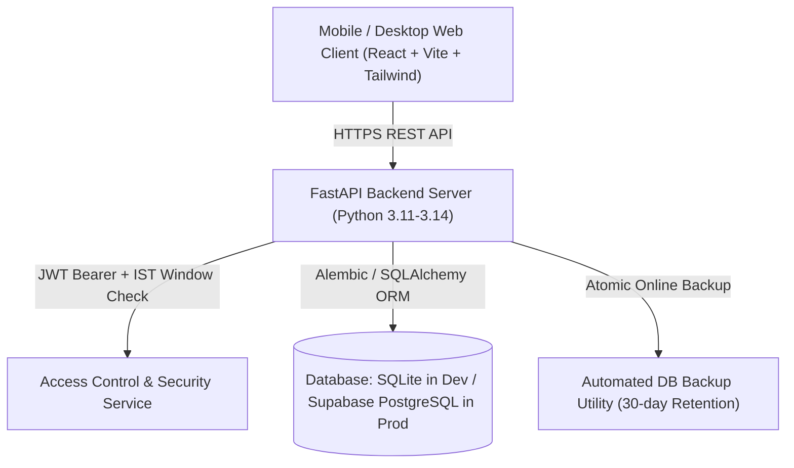

# BandhSetu — Smarter Bandhej Artisan & Business Management

[](https://fastapi.tiangolo.com)
[](https://react.dev)
[](https://www.typescriptlang.org)
[](https://tailwindcss.com)
[](https://www.postgresql.org)
[](https://opensource.org/licenses/MIT)

**BandhSetu** is a production-ready enterprise management web application engineered specifically for Indian Bandhej (Bandhani) textile manufacturing businesses managing 200–500 artisan women workers in Gujarat (Jamnagar, Bhuj, Mandvi, Anjar, and Kutch craft clusters).

---

## Key Highlights

- **Role-Based Access Control (RBAC)**:
  - **Owner / Administrator**: 24/7 unrestricted access, catalogue pricing, manager approval/lock controls, audit trails, and financial reporting.
  - **Workshop Manager**: Strictly permitted between **09:00 AM – 08:00 PM IST**. Automatic session revocation outside permitted hours.
  - **Manager Registration & Approval Gate**: Managers can self-register via the login screen and are placed in pending approval status until verified and activated by an administrator.
  - **Zero Login for Artisans**: Women artisans do not have logins; their accounts are tracked through double-entry ledgers.
- **Bilingual English & Gujarati Localization**:
  - Full native Gujarati (ગુજરાતી) support across the entire interface (Khata, work distributions, payments, artisan directory, and settings).
- **Historical Price Protection**:
  - Consignments store an immutable unit rate snapshot (`rate_per_piece`). Subsequent catalogue price modifications never alter past batch contracts.
- **Strict Separation of Ledgers**:
  - **Material Ledger**: Worker-account perspective DEBIT (fabric given) and CREDIT (fabric returned).
  - **Money Ledger**: Worker-account perspective CREDIT (earned wages) and DEBIT (advances & wage payouts).
- **Quality Inspection & Partial Returns**:
  - Supports multiple partial returns against a single consignment.
  - Quality rejections (broken knots, torn fabric, dye bleed) earn **₹0.00** wage. Wages accrue **only** on accepted pieces.
- **Duplicate Payment Prevention**:
  - Prevents reusing payment reference numbers (UPI UTR / Bank Ref) and guards against rapid double-clicks.
- **10 Real-Time Dashboard KPI Cards & 10 Specialized Reports**:
  - Instant aggregation of registered artisans, pieces in custody, wages earned, advances, payouts, and net outstanding balances.
  - Multi-format export: Native Excel/CSV and print-optimized PDF view.
- **Mobile-First Design**:
  - Ergonomically tuned for one-handed operation on 360px and 390px mobile screens, tablets, and desktops.
  - Touch targets $\ge 44\text{px}$ with `touch-manipulation`.

---

## System Architecture



---

## Technology Stack

| Layer | Technology | Key Libraries / Frameworks |
|---|---|---|
| **Frontend** | React 18, Vite 6, TypeScript 5.5 | Tailwind CSS, React Router v6, Lucide React, KaTeX |
| **Backend** | Python 3.11–3.14, FastAPI 0.115 | Pydantic v2, SQLAlchemy 2.0, Alembic, Uvicorn, PyJWT, bcrypt |
| **Database** | SQLite (Dev) / PostgreSQL 15+ (Prod) | Supabase Cloud, Connection Pooling, Row Level Security |
| **Deployment** | Vercel (Frontend) + Render (Backend) | Automatic HTTPS, Health Checks, Environment Isolation |

---

## Quick Start (Localhost Development)

### 1. Backend (FastAPI)
```bash
# Navigate to backend
cd backend

# Create and activate virtual environment (Windows PowerShell)
python -m venv venv
.\venv\Scripts\activate

# Install dependencies
pip install -r requirements.txt

# Run migrations (creates SQLite database bandhej_dev.db)
alembic upgrade head

# Start API server
uvicorn app.main:app --reload --port 8000
```
- API Documentation: [http://localhost:8000/docs](http://localhost:8000/docs)
- Health Check: [http://localhost:8000/api/v1/health](http://localhost:8000/api/v1/health)

### 2. Frontend (React + Vite)
```bash
# In a new terminal tab, navigate to frontend
cd frontend

# Install dependencies
npm install

# Start development server
npm run dev
```
- Web Application: [http://localhost:5173](http://localhost:5173)

---

## Workshop Credentials & Access Parameters

| Role | Name | Email | Mobile Number | Password | Operating Window |
|---|---|---|---|---|---|
| **Primary Admin / Owner** | Pragnesh Vinchhi | `dev.vinchhi@gmail.com` | `+919426927175` | `admin@123` | **24/7 Unrestricted** |
| **Executive Admin** | Hetal Vinchhi | `hetal@bandhej.com` | `+919537335737` | `admin@123` | **24/7 Unrestricted** |
| **Workshop Manager** | Jiya Vinchhi | `jiya.vinchhi2412@gmail.com` | `+919426927907` | `admin@123` | **09:00 AM – 08:00 PM IST** |

> **Note on Manager Registration**: Additional managers can register directly via the "Create Account / Register" option on the login screen. Newly registered managers remain in **Pending Approval** status until verified and approved by an administrator in the **Manager Access** panel.

---

## Documentation Suite

Detailed documentation is available in the repository:

- 📖 **[Local Setup Guide](LOCAL_SETUP.md)**: Detailed local environment setup, virtual environment, migrations, and test running.
- 🚀 **[Cloud Deployment Guide](DEPLOYMENT.md)**: Production deployment to Supabase (PostgreSQL), Render (FastAPI), and Vercel (React).
- 🗄️ **[Database Schema Documentation](DATABASE_SCHEMA.md)**: Complete 10-table data dictionary, foreign keys, constraints, and historical snapshot rules.
- 🔌 **[REST API Documentation](API_DOCUMENTATION.md)**: Endpoints, request/response formats, error codes, and curl examples.
- 📘 **[Business Operations User Guide](USER_GUIDE.md)**: Workflow walkthrough for Owner and Manager from worker registration to payments.
- 🛡️ **[System Architecture & Security Reference](bandhsetu_system_architecture_and_security.md)**: Complete technical specification of backend services, database schema, and security layers.

---

## Verification & Test Suites

```bash
# Run Master E2E & Security Test Suite (14 scenarios)
$env:PYTHONPATH="backend"; .\backend\venv\Scripts\python.exe -u backend\tests\test_master_e2e_verification.py

# Run Analytics & Reporting Tests (10 KPI cards + 10 reports)
$env:PYTHONPATH="backend"; .\backend\venv\Scripts\python.exe -u backend\tests\test_analytics_and_reports.py

# Run Authentication & Manager Window Tests (10 tests)
$env:PYTHONPATH="backend"; .\backend\venv\Scripts\python.exe -u backend\tests\run_security_tests.py

# Run Frontend Production Build & TypeScript Typecheck
cd frontend && npm run build
```

---

## License

MIT License. Copyright &copy; 2026 BandhSetu Enterprise.
